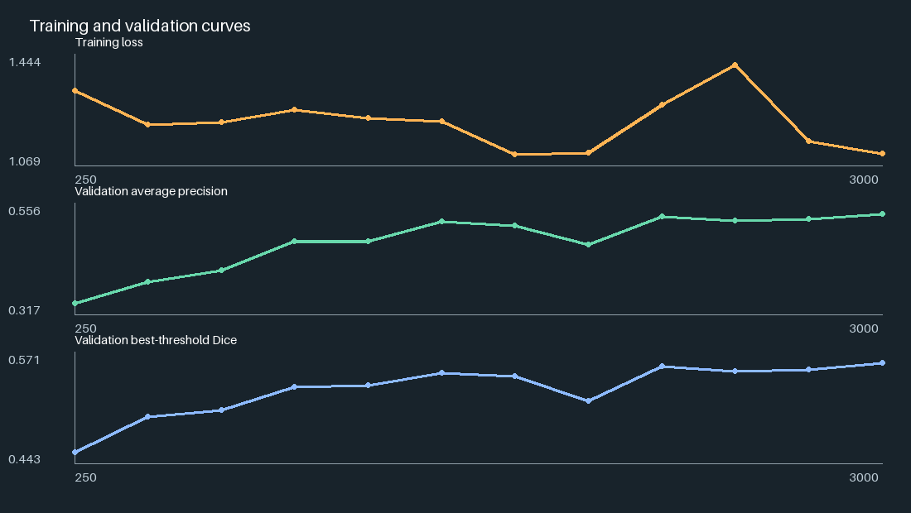
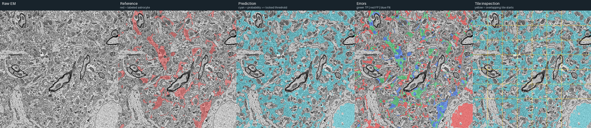
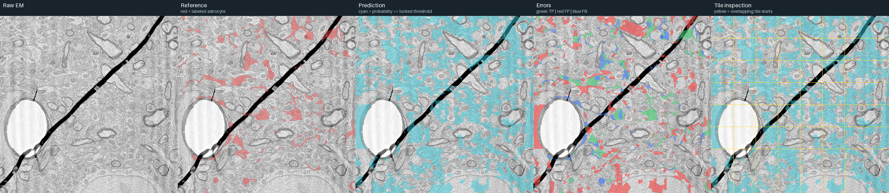

# Exploratory astrocyte 3D segmentation baseline

This document summarizes an exploratory 3D U-Net baseline for segmenting a
partially labeled astrocyte in MICrONS EM. It is a reproducibility record, not a
validated biological segmentation pipeline.

## Why the final baseline was needed

The baseline followed a sequence of controlled diagnostics rather than a direct
model choice:

1. A small 2D U-Net memorized one fixed 256 x 256 patch, confirming that the
   implementation and labels contained a learnable signal.
2. Full 512 x 512 training was slower and unstable, so 256 x 256 patches were
   retained for early diagnostics.
3. Fixed training pools were expanded from 1 to 4, 16, 64, and 128 patches.
   Rotation/flip augmentation and larger pools did not yield proportional
   validation improvements.
4. The handmade 2D model often became overly conservative under changing random
   patches. Foreground-aware sampling and foreground-weighted BCE did not fully
   resolve generalization.
5. A 2.5D input added neighboring sections, followed by label and resolution
   audits and a lightweight handmade 3D U-Net.
6. The final lightweight nnU-Net-style variant combined robust per-volume
   normalization, GroupNorm, LeakyReLU, cosine learning-rate decay, balanced
   sampling, and validation-based checkpoint selection.

This progression helped separate patch memorization, class imbalance, limited
context, normalization, and sampling effects.

## Frozen protocol

- Data: 12 cell-level MIP2 volumes at 32 x 32 x 40 nm per voxel
- Split: sample_01-08 training, sample_09-10 validation, sample_11-12 test
- Patch: 16 x 128 x 128 voxels (ZYX)
- Sampling: balanced foreground, uniform, and confirmed-neuron hard negatives
- Augmentation: XY 90-degree rotations and X/Y flips
- Model: lightweight 3D U-Net with GroupNorm and LeakyReLU
- Normalization: per-volume 0.5/99.5 percentile clipping followed by z-score
- Optimization: Adam, 3,000 steps, cosine learning rate from 3e-4 to 3e-5
- Selection: validation average precision (AP), then validation Dice
- Threshold: selected on validation data and frozen before test evaluation

## Quantitative results

| Evaluation | AP | Dice | IoU | Precision | Recall |
| --- | ---: | ---: | ---: | ---: | ---: |
| Validation patches | 0.533 | 0.559 | - | - | - |
| Test patches | 0.419 | 0.465 | 0.303 | 0.339 | 0.737 |
| Fixed full test sections | 0.380 | 0.457 | 0.296 | 0.365 | 0.612 |

The whole-section protocol uses sample_11 and sample_12 at Z = 32, 64, and 96,
with 50% XY overlap and Hann-weighted probability blending. These exact sections
and stitching settings should be reused for every preprocessing run.

## Whole-section visual results

Each row shows raw EM, the reference mask, the thresholded prediction, an error
map, and the prediction with overlapping tile starts. In the error map, green is
true positive, red is false positive, and blue is false negative.

The overlays reveal two limitations that patch-level metrics did not show clearly:

- Confirmed neuronal regions account for the scored false positives in the
  dedicated false-positive audit.
- A tile-dependent block pattern remains after blending. With 50% overlap, the
  mean probability jump at tile starts is 1.24-1.35 times the normal neighboring
  pixel jump across the six evaluated sections.

## Reproduction entry points

- `scripts/train_partial_astrocyte_3d.py`: model, partial-label handling, and
  validation utilities
- `scripts/train_multicell3d_patch_pool.py`: reproducible fixed-pool diagnostics
- `scripts/train_multicell3d_controlled_random.py`: controlled random baseline
- `scripts/evaluate_multicell3d_final_test.py`: frozen patch-based test
- `scripts/evaluate_multicell3d_whole_sections.py`: stitched full-section test and
  figures
- `scripts/audit_multicell3d_false_positives.py`: label-code false-positive audit

Generated volumes, checkpoints, and run directories remain under the Git-ignored
`samples/` directory.

## Limitations

- The main baseline currently has one random seed.
- Labels are partial. Unscored regions cannot be treated as confirmed background.
- The current inputs are MIP2 rather than native MIP0.
- sample_11 and sample_12 have been consumed as the final test set.
- The 12 cell-level volumes should not automatically be treated as independent
  biological replicates.
- Visible patch-border/context artifacts remain in whole-section inference.

The next controlled comparison should keep the architecture, split, training
schedule, held-out sections, stitching, and evaluation mask fixed while changing
only the preprocessing input.
