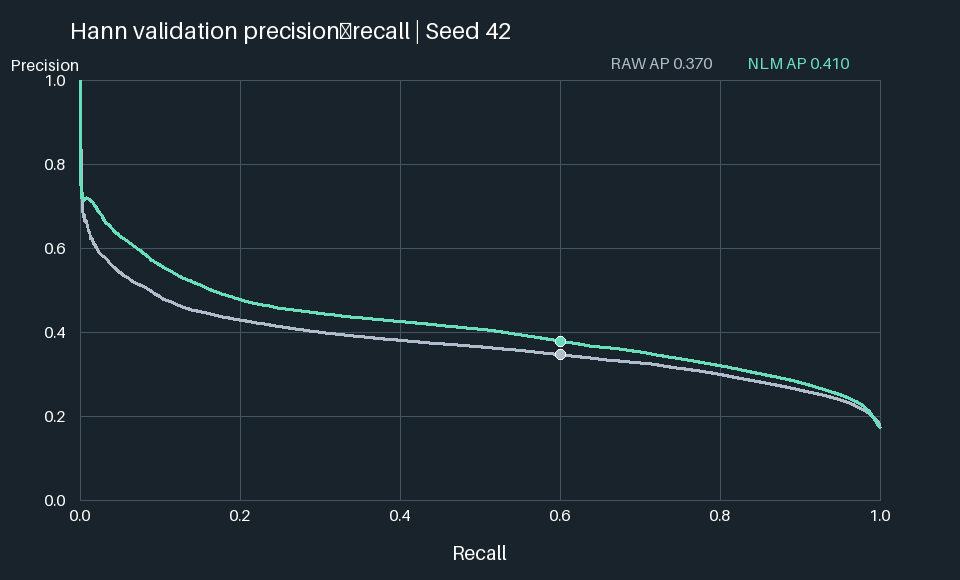
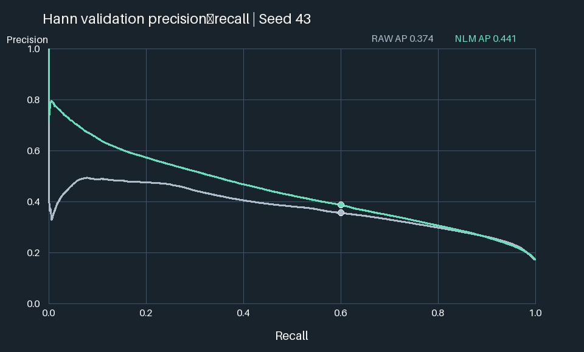
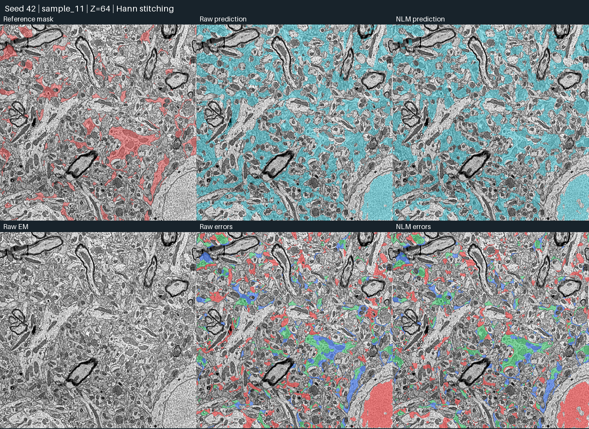
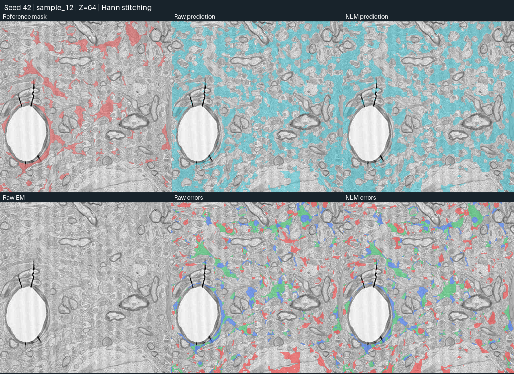

# MIP2 preprocessing and whole-section segmentation

We compared raw MIP2 EM with mild slice-wise non-local means (NLM) using a
lightweight 3D U-Net, 3,000 training steps per run, and paired seeds 42 and 43.
NLM used h = 2/255 on a [0, 1] intensity scale, a 5 × 5 patch, and a search
distance of 6 pixels. Both inputs used per-volume percentile clipping and
z-score normalization. The 500-step pilot also included CLAHE.

Training used samples 01–08 and 16 × 128 × 128 voxel patches. Predictions were
stitched using 50% XY overlap and Hann weights. We selected each decision
threshold for highest precision at a minimum of 60% recall on samples 09–10.
Test metrics use those frozen thresholds and the same partially labeled
sections (Z = 32, 64, and 96 in samples 11–12).

| Seed | Input | Test AP | Dice | Precision | Recall |
| --- | --- | ---: | ---: | ---: | ---: |
| 42 | Raw | 0.380 | 0.451 | 37.5% | 56.7% |
| 42 | NLM | 0.418 | 0.483 | 40.7% | 59.3% |
| 43 | Raw | 0.426 | 0.490 | 38.8% | 66.5% |
| 43 | NLM | 0.490 | 0.517 | 42.9% | 65.0% |

NLM improved AP, Dice, and precision in both paired runs. This comparison reused
the same two test cells and measures repeatability across seeds on those cells.
Under direct full-XY inference, seed 42 Raw and NLM both reached approximately
0.535 Dice, so results depend on the evaluated inference workflow.

## Validation precision–recall

## Matched whole-section examples

Seed 42, Z = 64 for both cells. Cyan marks predictions. Red in the reference
panel marks labeled astrocyte. In error panels, green marks true positives,
red marks false positives on scored negatives, and blue marks false negatives.

